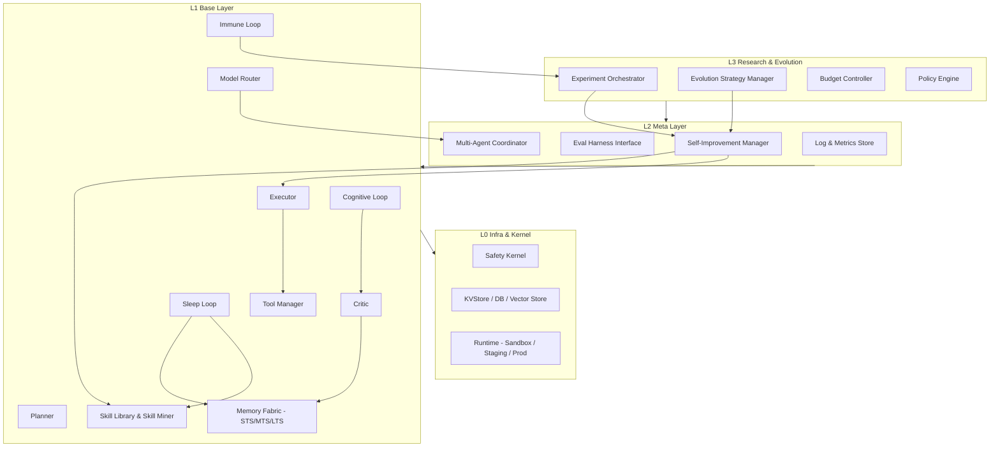

# Project Quentin – Meta-Agent OS Framework (Research-Integrated Edition)

[English](README.md) | [简体中文](README_CN.md)

> **Baseline Release Notice (12-Month Open Source)**  
> This repository represents a snapshot of the foundational architecture developed over 12 months. Production deployments and commercial iterations are maintained in separate private releases. Distributed under the MIT License.

A self-iterating, continuous learning, and self-programming **general agent operating system framework**.

Connect any LLM (local or cloud) and plug in your domain-specific tools (Desktop Automation, Legal, Financial Trading, Research, etc.) to conduct experiments in **continual learning, self-evolution, and safe self-programming**.

---

## ✨ Core Objectives

This repository implements the architectural blueprint of Meta-Agent v3:

1. **Domain & Model Agnostic**  
   - Zero vendor lock-in: Desktop, legal, algorithmic trading, or code synthesis are modular domain plugins.
   - LLM agnostic: Simple adapter interface (`call_llm`) supports local LLMs (Ollama, vLLM) and hosted endpoints.

2. **Safe Autonomous Evolution**  
   - **Continual Memory**: 3-tier `MemoryFabric` (Short-Term STS, Medium-Term MTS, Long-Term LTS) with decay and consolidation.
   - **Self-Programming Pipeline**: Sandboxed patch generator, automated test harness, safety gate, and rollback manager.
   - **Skill Mining**: Automated pattern mining from execution traces (`Trace` → `Episode` → `Skill Mining` → `Skill Library`).

3. **Research-Ready & Observable**  
   - Closed-loop telemetry for cognitive, immune, sleep, and evolutionary cycles.
   - Built-in Observability API compatible with Grafana and Prometheus monitoring stacks.
   - Modular research layer with `ExperimentOrchestrator`, `EvolutionStrategy`, `BudgetController`, and `PolicyEngine`.

---

## 🏗 Architecture Overview

The system is organized into a four-layer hierarchy with three logical execution tiers and a dedicated kernel boundary:



### Environment Isolation Boundaries

- **Sandbox**: Unrestricted runtime for self-programming experiments, patch compilation, and unit verification.
- **Staging**: Candidate patches and mined skills receive canary shadow execution.
- **Production**: Live mission execution protected by invariant gates.

> **Safety Invariant**: The `SafetyKernel` enforces an immutable boundary. Core execution logic cannot be modified by autonomous self-programming routines; only modules in designated `/mutable/` paths may receive automated updates.

---

## ⚙️ Key Feature Flags

- `QUENTIN_EXTERNAL_CONTENT_SHIELD`: Active shield against prompt injection from third-party tools (Default: `true`).
- `QUENTIN_SKILL_MD_ENABLED`: SOP workflow parser via markdown files (Default: `false`).
- `QUENTIN_SELFPROG_ISOLATED_WORKDIR`: Ephemeral isolated workspace for patch testing (Default: `false`).
- `QUENTIN_INTERACTIVE_SHELL_ENABLED`: Interactive shell execution tool (Default: `false`).
- `QUENTIN_WAKE_ENABLED`: Allow external event dispatch via `qctl wake` (Default: `true`).

---

## 🚀 Quick Start

### 1. Installation

Python 3.10+ recommended:

```bash
git clone https://github.com/chanaliuxing/quentin-agent-os.git
cd quentin-agent-os
pip install -e .
```

### 2. Inspect System Metrics

```bash
qctl metrics-overview
```

Expected output:
```json
{
  "timestamp": "2026-03-01T08:00:00",
  "model": { "models": {}, "total_calls": 0 },
  "memory": { "tiers": {"STS": 0, "MTS": 0, "LTS": 0}, "total": 0 },
  "immune": { "cases": 0 },
  "patches": { "patches": 0 },
  "experiments": { "experiments": 0 },
  "skills": { "skills": 0 },
  "sleep": { "episodes": 0 }
}
```

### 3. Launch Observability API

```bash
qctl serve-observability --host 0.0.0.0 --port 8000
```

Endpoints available:
- `http://localhost:8000/health`: System health probe.
- `http://localhost:8000/overview`: Aggregated telemetry for Grafana.
- `http://localhost:8000/models`: Active model registry and invocation quotas.

---

## 🧠 The Four Core Feedback Loops

1. **Cognitive Loop**: Mission decomposition → hierarchical planning → execution → critic reflexion → trace & memory writeback.
2. **Immune Loop**: Live anomaly and metric degradation detection triggering immediate circuit breaking and diagnostic capture (`ImmuneCase`).
3. **Sleep Loop**: Offline background worker aggregating episode traces, running pattern miners for skill candidates, and consolidating STS memory into durable LTS.
4. **Self-Programming Loop**: Autonomous patch synthesis in isolated scratch sandboxes, executing regression verification before presenting candidates to the policy engine.

---

## 📄 License

Distributed under the [MIT License](LICENSE).  
Copyright (c) 2026 Wei Zhang
